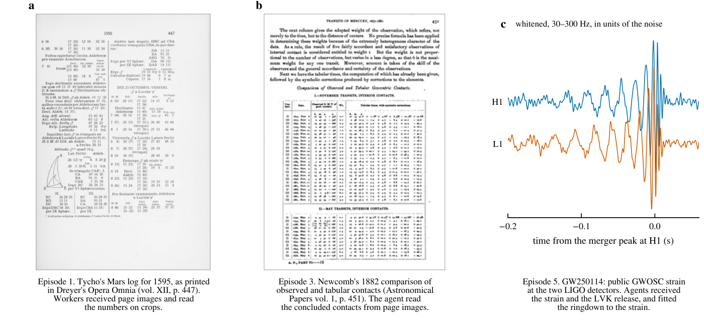
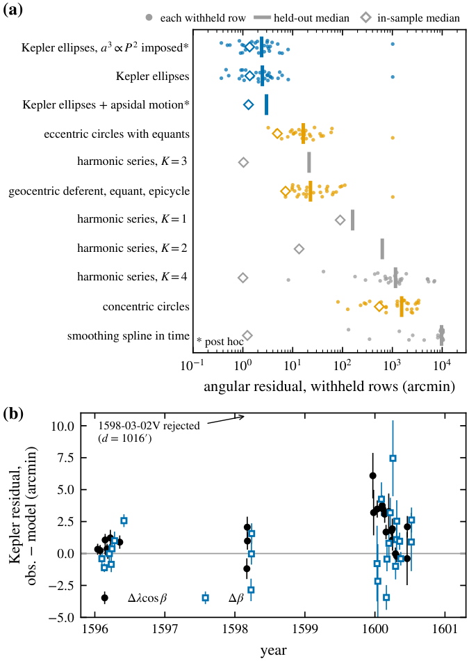
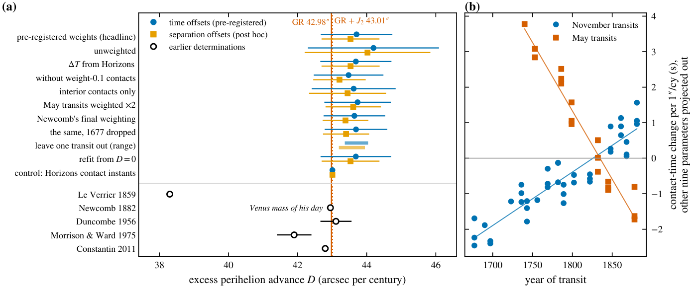
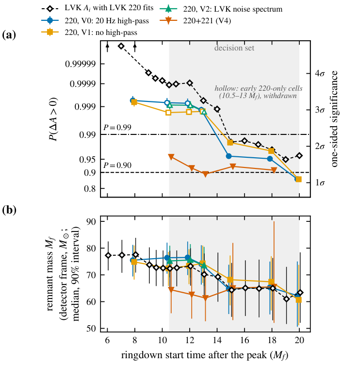
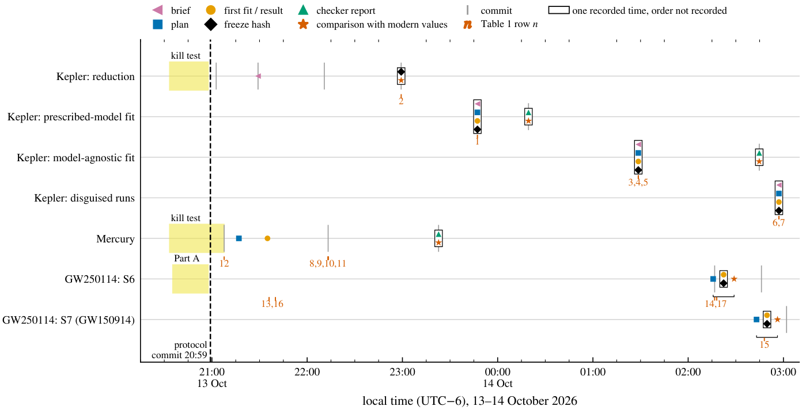

<div align="center">

# From the observations of Tycho Brahe to GW250114

### Three results in physics re-measured with the answer withheld

[](https://doi.org/10.5281/zenodo.23410498) [](https://doi.org/10.5281/zenodo.23410453) [](LICENSE) [](LICENSE-CC-BY-4.0.md)

**[Read the paper (PDF)](paper/FavioVazquez-2026-Tycho-Brahe-to-GW250114-answer-withheld.pdf)** · [Paper on Zenodo](https://doi.org/10.5281/zenodo.23410498) · [Dataset on Zenodo](https://doi.org/10.5281/zenodo.23410453) · [The record](#the-record)



<sub>The three records as the agents received them: Tycho's Mars log for 1595 in Dreyer's edition, Newcomb's comparison of observed and tabular contacts of Mercury, and the GW250114 strain at the two LIGO detectors (Extended Data Fig. 5).</sub>

</div>

---

Can AI agents redo a classic measurement of physics from the primary record, to a standard a physicist would accept, when they almost certainly know the textbook answer? This repository holds a paper that tries it three times, and the complete record of how it was done: every brief, plan, script, frozen hash, run log and checker report.

The agents were never told the expected answer. A written protocol kept it out of their instructions, fixed the comparison with modern values in advance, froze each result before that comparison and passed every measurement to a separate re-analysis agent. The paper reports what came out, and everything that went wrong along the way.

## Contents

- [TL;DR](#tldr)
- [The three results](#the-three-results)
- [How the protocol works](#how-the-protocol-works)
- [What the protocol caught](#what-the-protocol-caught)
- [What this does not show](#what-this-does-not-show)
- [The films](#the-films)
- [Repository layout](#repository-layout)
- [Key output files](#key-output-files)
- [Reproduce an episode](#reproduce-an-episode)
- [The record](#the-record)
- [Cite](#cite)
- [Licence](#licence)

## TL;DR

| | The record the agents read | What they measured |
|---|---|---|
| **Kepler** | Tycho Brahe's Mars logs, from page images of Dreyer's edition | Told no model family, an agent chose two Keplerian orbits about one common point, which predicted the withheld years 1596–1601 to a median of 2.46′. |
| **Mercury** | Newcomb's 58 concluded transit contacts of 1677–1881 | Fitted with a Newtonian model, they require an extra perihelion advance of 43.71 ± 1.04″ per century, 0.7σ above the 42.98″ general relativity predicts. |
| **GW250114** | the public LIGO strain, with the agents' own inspiral-only and ringdown fits | All 40 cells across both lanes favour growth of the horizon area, but the minimum probability, 0.86 at 20 M<sub>f</sub>, is below the pre-registered 0.90, so the rule withheld the claim. |

Along the way the protocol caught a brief that leaked the shape of the answer, an offset attributed to the wrong cause, a single-mode bias in the earliest ringdown fits and a failed run. Each was reported. The division of labour that emerged, with agents measuring, a separate agent checking and the author arbitrating, is the method the paper proposes.

## The three results

### 1. Kepler's orbit from Tycho's logs

<p align="center"></p>

Six agent workers transcribed 427 Mars sessions from page images of Tycho's logs, with a confidence on every number. The orchestrating agent reduced 349 of them to geocentric positions; the 187 with good quality flags form the frozen data product, at a median residual of 1.38′ against the modern ephemeris, which was used only for verification.

A fitting agent was then told nothing about model families. Every row after mid-January 1596 was withheld, leaving 159 rows for fitting and 28 for prediction. Two Keplerian ellipses about one common point predicted the withheld years to a median of 2.46′. Eccentric circles with equants reached 16.3′, and a harmonic series with no physics missed the withheld years by 21′.

Was the agent cheating by recognising Mars? Fresh agents received disguised copies of the data, with time rescaled, longitude rotated or mirrored and every label removed. Three runs found two Kepler ellipses again, with held-out medians of 2.05′, 2.13′ and 2.02′, and identified the data as Mars only after the fit. The disguise shows that recognition followed the fit; it cannot show that knowledge played no part in which families the agents chose to try. ([Paper, Section 3.1](paper/FavioVazquez-2026-Tycho-Brahe-to-GW250114-answer-withheld.pdf))

### 2. Mercury's perihelion from Newcomb's transit contacts

<p align="center"></p>

The record is Newcomb's 58 concluded contacts from 23 transits of 1677–1881, with the weights he printed. The instructions named no expected value and no theory. A Newtonian N-body model with an extra uniform perihelion advance D gives D = 43.71 ± 1.04″ per century: 0.7σ above the 42.98″ general relativity predicts. The historical contacts fix the excess advance to 2.4% (1σ), and every variant tried lies between 43.2 and 44.3. Run on the modern ephemeris's own contact instants, the same pipeline returns 43.007, which validates the pipeline but says nothing about the historical data. ([Section 3.2](paper/FavioVazquez-2026-Tycho-Brahe-to-GW250114-answer-withheld.pdf))

### 3. Did the horizon area of GW250114 grow?

<p align="center"></p>

Hawking's area theorem says a black hole merger cannot shrink the total horizon area; LVK report growth at 4.4σ on a Gaussian statistic. The agents asked the same question with their own ringdown fits and the exact one-sided probability P(ΔA > 0), under a decision rule fixed before any area was computed.

The earliest reading did not survive. The 220-only (single-mode) fits gave P of 0.998–0.999 at 10.5–13 M<sub>f</sub>, but their remnant mass fell by 9.3 M<sub>☉</sub> between 13 and 15 M<sub>f</sub>, the signature of a known single-mode bias. A pre-registered overtone test confirmed it, and those cells were withdrawn. P(ΔA > 0) is then 0.89–0.96 for fits that include the 221 overtone and start 10.5–13 M<sub>f</sub> after the peak, 0.91–0.98 at 15–18 M<sub>f</sub>, and 0.86 at 20 M<sub>f</sub>. The minimum is below the pre-registered 0.90, so the rule gives its fourth sentence: whether the area grew depends on analysis choices, and with these ringdown fits the paper cannot claim it.

> [!NOTE]
> This is not evidence against the area theorem, since every combination favours an increase, and it does not show that LVK's result is wrong. The agents' initial area is 6.6% larger than LVK's, and in a post-hoc check with it lowered to LVK's value P<sub>min</sub> becomes 0.917, where the rule would give the third sentence, "the data favour an increase". ([Section 3.3](paper/FavioVazquez-2026-Tycho-Brahe-to-GW250114-answer-withheld.pdf))

## How the protocol works

<p align="center"></p>

The protocol was written on 13 October 2026 and committed before any batch transcription, reduction or fit ([`remeasured/PROTOCOL.md`](remeasured/PROTOCOL.md)). In order:

1. **The brief withholds the answer.** Agents get the data and a question, never the expected answer or its shape: "find the orbit that fits these positions", not "fit an ellipse"; "what drift of Mercury's perihelion is left after the planets?", not "find 43″".
2. **A kill test with a pass criterion** shows the record can be read at all. For Tycho: agreement with the ephemeris within 5′ on two nights transcribed by hand.
3. **A plan** fixes models, outlier rule, uncertainty recipe and decision rule before the result.
4. **A freeze.** Each Kepler fitter wrote the sha256 of its result to `FROZEN.txt`; episode 5 recorded the hash of each status version.
5. **A checker**, a separate agent with read-only access, re-runs the code and compares the result with modern values, grading its findings as blocker, should-fix or polish.
6. **The comparison is fixed in advance.** For Mercury it was 42.98″ per century.
7. **A record** of every run, kept in git. Additions made after a result was seen are labelled post hoc.

Figure 1 above marks where the execution fell short of this, episode by episode. The paper's Section 2 states each gap.

## What the protocol caught

The paper's Table 1 lists every deviation, failure and correction. The main ones:

| Episode | What happened | Caught by | Consequence |
|---|---|---|---|
| Kepler | The prescribed-model brief named the model families and Kepler's 8′. | checker | Run relabelled as a measurement under prescribed models; model-agnostic re-run; deviation recorded. |
| Kepler | The 1600 offset was attributed to Tycho's data. | checker | Shown not to be in the data; attributed, by inference, to the model's extrapolation. |
| Kepler | Disguised run beta failed to reach the two-ellipse basin. | the run itself | Reported; declared rerun beta2 succeeded. |
| Mercury | The pre-registered nuisance model is nearly degenerate; the first fit crashed and the main run stalled. | the fitting agent | Converged wide fit gives the headline; post-hoc radial form beside it. |
| Mercury | The headline traced only to the log of a stopped run. | checker | Converged fit writes the headline file. |
| Mercury | An "error in Newcomb" was Newcomb's own corrigendum. | checker | Wording corrected; no claim of a new error. |
| GW250114 | The strongest cells (220-only, 10.5–13 M<sub>f</sub>) sat where single-mode bias is expected. | checker | Pre-registered overtone test passed; those cells withdrawn. |
| GW250114 | The i.i.d. standard error of P at 20 M<sub>f</sub> understated the uncertainty. | checker | Autocorrelation-aware s.e.; P = 0.86 ± 0.01 at 20 M<sub>f</sub>; sentence unchanged. |
| GW250114 | The sampler ignored the seed in both inspiral-only runs. | arbiter | Runs identified by checksum; not bit-reproducible. |

Explanations failed more often than measurements: twice the agents' interpretations ran ahead of their evidence, and both times a second agent with different information corrected them. The measurement stood each time; the interpretation was withdrawn. (The arbiter in the table is the author.)

## What this does not show

> [!NOTE]
> **The agents know the textbook answers.** Withholding the answer, fixing the plan, holding out data and disguising the record narrow what that knowledge can do; none removes it.

> [!NOTE]
> **The checker is an AI agent started by the author, not an independent expert.** A human domain expert's reading of each measurement is still due, as are an independent re-transcription of Tycho's logs, a re-reduction of Newcomb's individual Mercury rows and the open items of the GW250114 analysis (Section 3.3 and Supplementary Section S3 of the paper).

> [!NOTE]
> **The evidence that plans came first varies.** In the Kepler and Mercury episodes it rests on statements, logs and file times rather than on version history; in episode 5 the plan preceded the area computation but not the 220-only (single-mode) ringdown fits. Section 2 of the paper says where the record falls short.

> [!NOTE]
> **GW250114: the claim was withheld, not refuted.** The minimum P of 0.86 is below the pre-registered 0.90. The paper does not claim the area grew, and does not claim it did not.

## The films

Three short films walk through the records and the results. They play on the [paper's page](https://roadtoreality.dev/tycho-to-gw250114/#films).

| Film | What it shows |
|---|---|
| GW250114 | The detector strain of GW250114 from GWOSC, with the orbit and the black holes drawn in time with it, then the area test and the rule that withheld the claim. |
| Kepler from Tycho's logs | Tycho's positions of Mars with the years 1596–1601 withheld, and the two Keplerian orbits that predicted them to a median of 2.46′. |
| Mercury from Newcomb's contacts | Newcomb's 58 transit contacts of 1677–1881, fitted with a Newtonian model, and the extra perihelion advance of 43.71 ± 1.04″ per century that they require. |

Every number in the films comes from the paper or its deposited record. The films were made with [showtime](https://github.com/FavioVazquez/showtime).

## Repository layout

```text
.
├── paper/                      the paper (the Zenodo deposit file)
├── docs/figures/               the paper's figures as PNG, for this page
├── remeasured/                 the record, byte-identical to roadtoreality@b6b0b05
│   ├── PROTOCOL.md             the written protocol
│   ├── ep1-kepler-tycho/       Kepler from Tycho's Mars logs
│   │   ├── fetch.sh            download the page scans; SHA256SUMS checks them
│   │   ├── transcriptions/     the six workers' transcriptions, merged
│   │   ├── reduce.py, out/     reduction to positions; the frozen product
│   │   ├── blind-fit/          prescribed-model fit: PLAN, REPORT, FROZEN, REFEREE
│   │   ├── agnostic-fit/       model-agnostic fit with the later years withheld
│   │   └── disguised/          disguised runs alpha, beta, beta2, gamma
│   ├── ep2-newton/             Newton's Moon test and Jupiter's satellites
│   ├── ep3-mercury-transits/   Mercury from Newcomb's contacts: scripts/, out/
│   ├── ep5-gw250114-area/      the horizon area of GW250114
│   │   ├── out/                STATUS.md, configs/, scripts/, results/, logs/, prereg/
│   │   ├── premerger-box/      inspiral-only posterior, lane 1 (headline lane)
│   │   ├── premerger/          inspiral-only posterior, lane 2, with its scripts
│   │   ├── premerger-lane2/    lane 2's GW150914 posterior (calibration)
│   │   └── showtime/tools/     two data helpers for a visualisation; not analysis
│   └── paper/                  prior-art notes
├── CITATION.cff
├── LICENSE                     MIT, for code
└── LICENSE-CC-BY-4.0.md        CC BY 4.0, for text, data and figures
```

## Key output files

Every result file the paper cites is here, next to the plan, brief and report that say how it was made.

**Kepler** (`remeasured/ep1-kepler-tycho/`)

| File | What it holds | Main fields |
|---|---|---|
| `out/mars_positions.csv` | the frozen data product: Tycho's Mars sessions reduced to geocentric positions (sha256 in `out/mars_positions.sha256`) | `session_id`, `jd_tt`, `lon_deg`, `lat_deg` (ecliptic of date), `sigma_lon_arcmin`, `sigma_lat_arcmin`, `site`, `flags` |
| `out/BATCH.md` | every session checked against the modern ephemeris, for verification only | residuals and quality class per session |
| `agnostic-fit/MODEL.json` | the model-agnostic fit's result; its sha256 is in `FROZEN.txt` | `winner_preregistered`, `winner`, `other_physical_models`, `scores`, `search_log` |
| `agnostic-fit/work/results.json` | every family the fitter tried | `table` (`family`, `k_params`, `BIC_common_train`, ...), `params`, `masks` |
| `disguised/README.md` | the disguised runs | disguise, outcome, winning model and held-out score of each run |

**Mercury** (`remeasured/ep3-mercury-transits/`)

| File | What it holds | Main fields |
|---|---|---|
| `out/measure_input.csv` | the 58 contacts as fitted | `transit`, `contact`, `weight`, `jd_ut_obs`, `jd_tt_obs_em`, `jd_tt_horizons`, ... |
| `out/fit_time_wide_headline.json` | the headline: the pre-registered time-offset form at its converged point | `D` (″ per century), `sigma_D`, `wrms_s` |
| `out/fit_results.json` | closures, the control run on the ephemeris's own contacts, the historical fits and their variants | per fit: `label`, `D`, `sigma_D`, `sigma0_s`, `params` |
| `out/residuals_summary.csv` | observed minus computed for every contact, beside Newcomb's own | `transit`, `contact`, `weight`, `oc_s`, `newcomb_oc_s`, `note` |

**GW250114** (`remeasured/ep5-gw250114-area/out/`)

| File | What it holds | Main fields |
|---|---|---|
| `results/area_task4.csv` | P(ΔA > 0) for every cell of both lanes; `decision_set` marks the cells the rule uses | `premerger`, `start_Mf`, `variant`, `decision_set`, `frac_med`, `frac_q05`, `frac_q95`, `P`, `P_se`, `Ai_med_m2`, `Af_med_m2` |
| `results/area_task8_checks.csv` | fragility and autocorrelation-aware standard errors of each decision cell | `P`, `se_iid`, `se_ess`, `se_reported`, `P_drop_top5` |
| `results/area_task9_scale.csv` | the post-hoc check with the initial area scaled to LVK's level | `P_nominal`, `P_a_LVK_level`, `P_b_mass_prior` per cell |
| `results/ringdown/<label>_summary.json` | quantiles and convergence of each ringdown fit | `m_det_Msun_q05_q50_q95`, `chi_q05_q50_q95`, `rhat_m`, `ess_bulk_m`, `config`, `versions` |
| `STATUS.md` | the episode's running record in status sections; from status section S6 on, each pre-registration was saved before its results (copies in `prereg/`) | |
| `CHECKSUMS_outputs.tsv` | sha256 of every file under `out/`, the git-ignored ones included | |

The ringdown sample files (`<label>_posterior.npz`) hold the arrays `m` (remnant mass, detector frame, M<sub>☉</sub>), `chi` (dimensionless spin) and `f…`, `g…` (frequency and damping rate of each mode). Half of them are committed; the other 27, which the git history ignores, are in the dataset record.

## Reproduce an episode

Each episode starts the same way: the public sources are not in the repository, so a fetch script downloads them into the episode's git-ignored `data/` folder and a checksum list verifies them. The commands below are the ones the record gives, run from the episode folder. Exact package versions are in the record: `premerger/requirements.txt` and `out/logs/ws_pip_freeze_ringdown.txt` for GW250114, the checker reports for the others.

### GW250114: the area result from the committed posteriors

This is the quickest check of a headline and needs no strain data or sampling. Download `ringdown-samples.zip` from the [dataset record](https://doi.org/10.5281/zenodo.23410453), then:

```bash
cd remeasured/ep5-gw250114-area/out
unzip /path/to/ringdown-samples.zip -d /tmp
cp /tmp/ringdown-samples/*.npz results/ringdown/
L1=../premerger-box/GW250114_082203_IMRPhenomXPHM_fmax131_full_nlive1000_posterior.csv.gz
L2=../premerger/samples/GW250114_082203_premerger_posterior.csv.gz
python -I scripts/area_task4.py \
  --premerger lane1_XPHM_fmax131=$L1 --premerger lane2_XPHM_fmax131=$L2
git diff --stat results/area_task4.csv
```

It needs only numpy, pandas and scipy, and it rewrites `results/area_task4.csv` with the same bytes. The decision-set checks, the lane-choice rule and the post-hoc scaling are `scripts/area_task8_checks.py`, `scripts/area_task7_local.py` and `scripts/area_task9_scale.py`; `out/STATUS.md` gives the inputs of each.

### GW250114: from the strain

- **Strain:** `python scripts/fetch_gwosc.py` (in `out/`) downloads the GWOSC strain at the two LIGO detectors and records its checksums; `scripts/fetch_zenodo.py` fetches the LVK release files used for comparison.
- **Ringdown fits:** `scripts/ringdown_fit.py <label> <config.json>`, one config per fit in `out/configs/` (the overtone fits in `out/configs/task7/`), run in a folder that holds the strain files; `out/scripts/job_task7.sh` is the job that ran the overtone fits.
- **Inspiral-only posteriors:** in `premerger/`, `./fetch.sh`, then `scripts/launch.sh <EVENT> <f_c> --likelihood full --nlive 1000 --npool 8` and `python scripts/postprocess.py --run <EVENT>=out/<label>/<label>_result.json` (see `premerger/REPORT.md`). These runs take hours on eight cores, and they are not bit-reproducible: the sampler ignored its seed, so the committed posteriors are identified by checksum.

### Kepler from Tycho's logs

```bash
cd remeasured/ep1-kepler-tycho
python3 -m venv data/.venv && data/.venv/bin/pip install astropy numpy scipy pillow && bash fetch.sh
data/.venv/bin/python -I reduce.py transcriptions/merged.json
data/.venv/bin/python -I batch_report.py
```

`reduce.py` turns the agents' transcriptions into positions and checks each session against the modern ephemeris (it queries JPL Horizons); `batch_report.py` writes `out/BATCH.md` and the frozen product `out/mars_positions.csv`. The fits read only that file:

```bash
cp out/mars_positions.csv agnostic-fit/positions.csv
cd agnostic-fit && python3 fit.py
shasum -a 256 MODEL.json   # compare with FROZEN.txt
```

A rerun of these commands on 16 October 2026 wrote a `MODEL.json` whose sha256 matches `FROZEN.txt`, and a `work/results.json` identical to the committed one.

The prescribed-model fit is `blind-fit/fit.py` (copy `out/mars_positions.csv` into `blind-fit/` first), and each disguised run has its own `fit.py` and `positions.csv` under `disguised/`. `TRANSCRIBE-GUIDE.md` lists the transcription tools.

### Mercury from Newcomb's transit contacts

```bash
cd remeasured/ep3-mercury-transits
bash fetch.sh && shasum -a 256 -c SHA256SUMS
python -I scripts/measure_prep.py
python -I scripts/fit.py
EP3_WIDE=1 python -I scripts/fit_time_wide.py
EP3_WIDE=1 python -I scripts/finalize_time_wide.py
```

The model needs REBOUND (IAS15 integrator) besides numpy and scipy. Ephemeris replies are fetched from JPL Horizons on first use and cached in `data/horizons/`. `out/MEASUREMENT.md` lists every script and the file it writes, and `out/REFEREE.md` records the checker's re-run.

### Newton's Moon test and Jupiter's satellites

`bash fetch.sh`, then `python -I scripts/moon_test.py` and `python -I scripts/jupiter.py`, in `ep2-newton/`. This was a feasibility test, reported in Supplementary Section S1 of the paper.

## The record

The time-stamped history of this work is the `road-remeasured` branch of [github.com/FavioVazquez/roadtoreality](https://github.com/FavioVazquez/roadtoreality/tree/road-remeasured), at commit [`b6b0b05`](https://github.com/FavioVazquez/roadtoreality/commit/b6b0b053ce8173db8528a7a875945407f158ab54). The paper cites its commit ids and times as evidence, so that branch is never rewritten. A snapshot of the commit is frozen in the dataset record, [doi:10.5281/zenodo.23410453](https://doi.org/10.5281/zenodo.23410453), together with the 27 git-ignored ringdown posterior sample files.

This repository is the front door: `remeasured/` here is a byte-identical copy of `remeasured/` at that commit, made with `git archive`, in a fresh history. Git names every directory by the hash of its contents, so the copy is identical exactly when the two tree ids match:

```bash
git rev-parse HEAD:remeasured
```

It prints `ccef0ddb4947eec406d809209fb88aeca8617497`, the same id as `git rev-parse b6b0b05:remeasured` in roadtoreality. The record is unedited: some logs and scripts contain absolute paths and host names from the machines the analyses ran on.

## Cite

Please cite the paper; for the data and code, also cite the dataset.

```bibtex
@misc{vazquez2026tychotogw250114,
  author    = {V{\'a}zquez, Favio},
  title     = {From the observations of {Tycho Brahe} to {GW250114}: three results in physics re-measured with the answer withheld},
  year      = {2026},
  publisher = {Zenodo},
  doi       = {10.5281/zenodo.23410498},
  url       = {https://doi.org/10.5281/zenodo.23410498},
  note      = {Preprint}
}

@misc{vazquez2026tychotogw250114data,
  author    = {V{\'a}zquez, Favio},
  title     = {Road re-measured: ringdown posterior samples and code snapshot (commit b6b0b05)},
  year      = {2026},
  publisher = {Zenodo},
  doi       = {10.5281/zenodo.23410453},
  url       = {https://doi.org/10.5281/zenodo.23410453}
}
```

GitHub's "Cite this repository" button reads [`CITATION.cff`](CITATION.cff).

## Licence

Code (`.py`, `.js`, `.mjs`, `.sh`, `.html`, `.css` and similar) is under the [MIT licence](LICENSE). Everything else, including the paper, the figures, the reports, the logs and the result files, is under [CC BY 4.0](LICENSE-CC-BY-4.0.md). The public sources the analyses read (Dreyer's *Opera Omnia*, Newcomb's *Astronomical Papers*, the GWOSC strain data and the LVK GW250114 release) are not included and keep their own terms; each episode has a fetch script and a checksum list for them.

<sub>Author: Favio Vázquez, independent researcher · ORCID [0009-0005-4591-1873](https://orcid.org/0009-0005-4591-1873). The analyses were run by AI agents under the written protocol, with the author designing the study and arbitrating every result; the paper's Methods M4 describes the roles.</sub>
